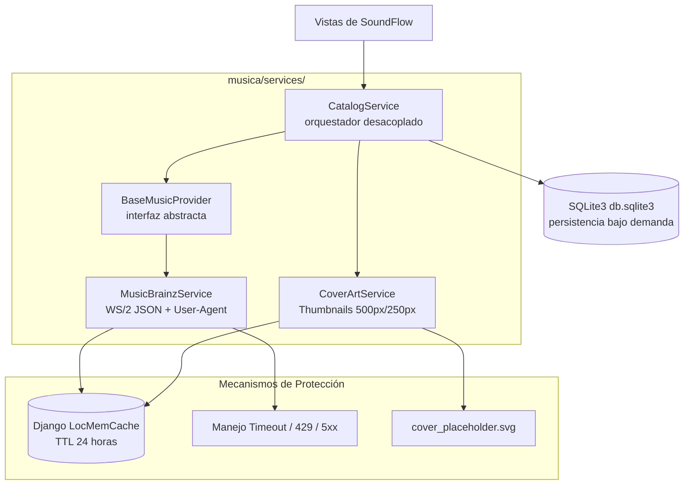

# INFORME TÉCNICO DE MODIFICACIONES E INTEGRACIÓN
## Proyecto: CallCenterGamer + SoundFlow (Evaluación N° 3 / Ampliación Módulo Musical)

---

## 1. RESUMEN EJECUTIVO

El presente informe documenta la incorporación de una segunda aplicación web de contenido musical denominada **SoundFlow** al sistema existente de **CallCenterGamer**, siguiendo estrictamente la directriz de:
> *"Conservar el proyecto original y agregar la segunda aplicación musical como un módulo nuevo e independiente"*.

La integración se completó con éxito garantizando compatibilidad retroactiva al 100%, manteniendo la base de datos relacional exclusiva **SQLite3**, conservando todas las rutas y vistas del Call Center, y ampliando la cobertura de pruebas automatizadas a **47 tests** (28 originales + 19 nuevos) sin ninguna regresión.

---

## 2. REGISTRO DE ARCHIVOS DEL PROYECTO

### 2.1 Archivos Nuevos Creados (Aplicación `musica/`)

| Ruta Relativa | Propósito / Responsabilidad |
| --- | --- |
| `musica/apps.py` | Configuración de la aplicación Django `musica` (`MusicaConfig`). |
| `musica/__init__.py` | Declaración del paquete y carga de `default_app_config`. |
| `musica/models.py` | Modelos de SoundFlow: `Genero`, `Artista`, `Album`, `Cancion`, `Playlist`, `ElementoPlaylist`, `Favorito`, `PlanSuscripcion`, `Suscripcion`, `Descarga`, `Resena`, `HistorialEscucha` y el conector `ContenidoMusical`. |
| `musica/admin.py` | Registro de todos los modelos musicales en el panel nativo de administración de Django (`/admin/`). |
| `musica/selectors.py` | Capa de selectores optimizados para la biblioteca de usuario y suscripción activa. |
| `musica/forms.py` | Formularios limpios: `PlaylistForm`, `ResenaForm` y `TicketMusicaForm`. |
| `musica/services/base.py` | Interfaz conceptual abstracta `BaseMusicProvider` para desacoplar el catálogo de la API concreta. |
| `musica/services/musicbrainz.py` | Cliente HTTP resiliente para el Web Service v2 de MusicBrainz con timeouts (8s), User-Agent institucional, control de 429/5xx y caché. |
| `musica/services/cover_art.py` | Cliente HTTP para Cover Art Archive con obtención de miniaturas (thumbnails de 500px/250px), caché y fallback a imagen local. |
| `musica/services/catalog.py` | Servicio orquestador: búsqueda híbrida (local primero, externa complementaria), sincronización bajo demanda y motor de recomendaciones explicables. |
| `musica/views.py` | Controladores de SoundFlow: portada, catálogo, buscador híbrido, fichas de detalle, playlists, biblioteca, suscripciones, descargas simuladas y creación de tickets vinculados. |
| `musica/urls.py` | Enrutamiento bajo el namespace `'musica'`. |
| `musica/tests.py` | Suite de 19 pruebas automatizadas con Mocks (sin llamadas reales a internet) cubriendo éxito, 404, 429, timeout, SET_NULL, unicidad y flujo de tickets. |
| `musica/management/commands/seed_musica.py` | Comando idempotente de carga inicial: 5 géneros, 8 artistas demo, 12 álbumes demo, 31 canciones demo, 8 playlists, 4 planes y tickets demostrativos. |
| `musica/static/musica/css/soundflow.css` | Hoja de estilos inspirada en plataformas modernas de música: fondo carbón (`#121212`), tarjetas con elevación suave, tipografía moderna y verde acento (`#1DB954`). |
| `musica/static/musica/js/player.js` | Lógica interactiva en JavaScript del reproductor visual: play/pause simulado, avance/retroceso, barra de progreso clickeable, control de volumen y persistencia de sesión. |
| `musica/static/musica/img/cover_placeholder.svg` | Portada genérica local en formato vectorial SVG para garantizar que nunca se muestren enlaces rotos cuando no exista portada en Cover Art Archive. |
| `musica/templates/musica/base_musica.html` | Layout base con sidebar de navegación, barra superior, mensajes flash y reproductor persistente en la parte inferior. |
| `musica/templates/musica/inicio.html` | Pantalla de inicio con recomendaciones explicables, álbumes y playlists destacadas. |
| `musica/templates/musica/catalogo.html` | Catálogo musical local paginado con selector de géneros. |
| `musica/templates/musica/buscar.html` | Buscador híbrido con diferenciación clara entre catálogo local y resultados externos de MusicBrainz. |
| `musica/templates/musica/artista_detail.html` | Ficha del artista con biografía, canciones populares, discografía y botón de soporte. |
| `musica/templates/musica/album_detail.html` | Ficha del álbum con portada de Cover Art Archive, lista de pistas numeradas, módulo de reseñas y soporte. |
| `musica/templates/musica/cancion_detail.html` | Ficha de la canción con reproductor interactivo, favoritos, añadir a playlists, descarga simulada y soporte. |
| `musica/templates/musica/playlist_list.html` | Listado de playlists del usuario y públicas de la comunidad. |
| `musica/templates/musica/playlist_detail.html` | Detalle de playlist con orden secuencial de canciones y permisos de edición para el propietario. |
| `musica/templates/musica/playlist_form.html` | Formulario de creación y edición de playlists. |
| `musica/templates/musica/biblioteca.html` | Centro de colecciones del usuario: canciones favoritas, álbumes guardados, artistas seguidos y descargas offline simuladas. |
| `musica/templates/musica/suscripcion.html` | Catálogo de los 4 planes de suscripción y simulación interactiva de upgrades de cuenta. |
| `musica/templates/musica/ticket_musica.html` | Formulario de reporte y apertura de ticket precargado con el contenido musical. |
| `musica/templates/musica/mis_tickets.html` | Panel de seguimiento en SoundFlow de las solicitudes de soporte creadas por el usuario. |
| `musica/migrations/0001_initial.py` | Migración inicial de todas las tablas de la aplicación `musica`. |
| `online/migrations/0005_preguntas_contenido_musical.py` | Migración aditiva en la app `online` que incorpora el campo FK opcional en `Preguntas`. |

---

### 2.2 Archivos Originales Modificados y Justificación

| Archivo Original | Modificación Exacta Realizada | Justificación Técnica | Riesgo |
| --- | --- | --- | --- |
| `CallCenterGamer/settings.py` | 1. Agregado de `'musica'` a `INSTALLED_APPS`.<br>2. Configuración de `CACHES` (`locmem.LocMemCache`).<br>3. Configuración de variables `MUSICBRAINZ_*` y `COVER_ART_*`.<br>4. Agregado del logger `'musica'` en `LOGGING`. | Imprescindible para que Django reconozca los modelos, rutas, comandos y plantillas de la nueva app, gestione el caché y conecte los servicios externos. | Nulo. No altera ninguna directiva de seguridad ni bases de datos existentes. |
| `CallCenterGamer/urls.py` | Inclusión de `path('musica/', include('musica.urls'))` importando `include`. | Imprescindible para exponer las rutas web de SoundFlow en el enrutador central. | Nulo. Todas las rutas previas (`/`, `/Administracion/`, `/Inicio/`, `/Respuesta/`, `/Login/`, etc.) se conservan intactas. |
| `CallCenterGamer/brand_config.py` | Incorporación de categorías temáticas de música (`suscripciones`, `descargas`, `biblioteca`, `playlists`, `recomendaciones`, `reproductor`, `contenido_musical`, `problemas_tecnicos`) a la lista por defecto. | Permite que el clasificador heurístico y el formulario administrativo `TicketAdminForm` reconozcan y validen las categorías musicales sin borrar las anteriores. | Nulo. No modifica la firma de métodos ni altera las categorías originales (`hardware`, `software`, etc.). |
| `online/models.py` | Incorporación en `Preguntas` del campo FK `contenido_musical = models.ForeignKey('musica.ContenidoMusical', on_delete=models.SET_NULL, null=True, blank=True, related_name='tickets')`. | Permite vincular de forma relacional y estructurada el ticket de soporte con la pieza musical reportada por el usuario, evitando acoplamiento frágil a cadenas de texto o URLs externas. | Muy bajo. Campo 100% aditivo con `null=True` y `SET_NULL`, protegiendo la integridad de todos los tickets históricos. |
| `online/templates/componentes/header.html` | Agregado del ítem de menú `SoundFlow` en la barra de navegación: `<li><a href=""><i class="fas fa-wave-square"></i> SoundFlow</a></li>`. | Permite a cualquier usuario acceder fluidamente a la aplicación musical desde el header corporativo del Call Center. | Nulo. Modificación de 1 línea dentro del layout HTML existente. |
| `online/templates/Respuestas.html` | Inclusión del panel condicional `` mostrando portada, título, artista, MBID y el botón "Abrir en SoundFlow". | Permite al cliente y al agente ver la ficha del contenido musical directamente en el chat del ticket. | Nulo. Si el ticket no es musical, la vista se renderiza idéntica a la original. |
| `administracion/templates/ModificarPregunta.html` | Agregado de la tarjeta `ia-card` con el bloque musical condicional `` y botón "Abrir en SoundFlow". | Permite que el técnico o administrador audite la pieza reportada abriendo su ficha interna con un solo clic. | Nulo. No modifica ningún input del formulario `TicketAdminForm`. |
| `requirements.txt` | Agregado de la dependencia `requests>=2.31.0`. | Necesaria para las peticiones HTTP del backend hacia MusicBrainz y Cover Art Archive en producción. | Nulo. Biblioteca estándar sin conflictos binarios. |
| `.env.example` | Documentación de las variables `MUSICBRAINZ_BASE_URL`, `MUSICBRAINZ_USER_AGENT`, `MUSICBRAINZ_TIMEOUT`, etc. | Guía para el despliegue y desarrollo sin incluir secretos reales. | Nulo. Solo archivo de ejemplo. |

---

## 3. MODELOS NUEVOS Y ESQUEMA DE DATOS

Para cumplir con la separación de responsabilidades y evitar duplicar funciones del Call Center, se diseñaron los siguientes modelos en `musica/models.py`:

1. **`Genero`**: Clasificación temática (`nombre`, `slug`).
2. **`Artista`**: Metadatos de artistas con identificador `mbid` (único, indexado), nombre, país, bio, géneros (M2M) y bandera `es_demo`.
3. **`Album`**: Lanzamientos musicales con `mbid` (único), relación con `Artista`, año, portada obtenida desde Cover Art Archive y fecha de sincronización.
4. **`Cancion`**: Pistas con `mbid` (único), título, relaciones con `Artista` y `Album`, duración en segundos y número de pista.
5. **`Playlist`**: Listas creadas por usuarios (`usuario` FK a `AUTH_USER_MODEL`), nombre, descripción, estado público/privado y bandera `es_demo`.
6. **`ElementoPlaylist`**: Relación M2M intermedia con orden secuencial (`orden`, `agregado`), con restricción `unique_together = ('playlist', 'cancion')`.
7. **`Favorito`**: Marcadores del usuario para canciones, álbumes, artistas o playlists, protegido con `UniqueConstraint` condicional para evitar duplicados.
8. **`PlanSuscripcion`**: Catálogo de los 4 planes oficiales (`gratuito`, `individual`, `familiar`, `estudiante`) con precios mensuales y beneficios.
9. **`Suscripcion`**: Suscripción activa del usuario (`OneToOneField` a `AUTH_USER_MODEL`), plan contratado y estado (`activa`, `cancelada`, `vencida`).
10. **`Descarga`**: Registros en SQLite de descargas offline simuladas (`usuario`, `cancion`, `fecha`, `estado`, `plataforma`).
11. **`Resena`**: Calificación de 1 a 5 estrellas (`clean()` con validación estricta de rango) y comentarios para álbumes o playlists.
12. **`HistorialEscucha`**: Trazabilidad de reproducciones simuladas para alimentar las recomendaciones explicables.
13. **`ContenidoMusical`**: Modelo conector que unifica cualquier elemento reportado en una sola clave foránea para el Call Center.

---

## 4. INTEGRACIÓN CON SERVICIOS EXTERNOS (MUSICBRAINZ Y COVER ART ARCHIVE)

### Arquitectura de la Capa de Servicios



### Características Técnicas Clave
- **Backend-Only**: Ninguna petición HTTP hacia MusicBrainz o Cover Art Archive se emite desde el cliente JavaScript ni desde plantillas HTML.
- **User-Agent configurable**: Cumple el requisito de MusicBrainz enviando `SoundFlow/1.0 ( contacto@example.com )`.
- **Timeouts controlados**: 8 segundos para MusicBrainz y 6 segundos para Cover Art Archive.
- **Prevención de sobrecarga**: Django Cache almacena en memoria cada respuesta exitosa por 24 horas y aplica caché negativo corto ante 404.
- **Normalización**: Las respuestas complejas de MusicBrainz se transforman en diccionarios limpios antes de llegar a las vistas.

---

## 5. FLUJO INTEGRADO DEL TICKET DE SOPORTE

1. **Navegación**: El usuario explora SoundFlow y encuentra una anomalía o duda en una canción, álbum, artista, playlist, suscripción o descarga.
2. **Activación**: Presiona el botón corporativo **"Contactar soporte"**.
3. **Persistencia del Conector**: La vista `ticket_desde_musica` recupera o genera un registro en `ContenidoMusical` en SQLite, asegurando que los metadatos sigan existiendo aunque se pierda la conexión a internet.
4. **Formulario Especializado**: Se precarga `TicketMusicaForm` con el título sugerido y la categoría temática correspondiente.
5. **Recepción en Call Center**: El ticket se persiste en `online_preguntas` con su clave foránea `contenido_musical`.
6. **Atención por el Agente**: El técnico o administrador ingresa a `/Administracion/` o `/Respuesta/<idPregunta>/` y visualiza la tarjeta del contenido musical con su portada y el botón **"Abrir en SoundFlow"**.
7. **Resolución y Auditoría**: El agente puede contestar, cambiar estado o asignar resolución; el cliente hace seguimiento desde `/musica/mis-tickets/` o desde el portal principal `/Inicio/<id>/`.

---

## 6. VERIFICACIÓN DE CONSERVACIÓN DEL PROYECTO ORIGINAL

Esta sección certifica formalmente que el sistema preexistente de Call Center Gamer permanece 100% operativo y no sufrió degradaciones:

### 6.1 Funciones Originales Probadas
- **Autenticación personalizada (`Usuario`)**: Login por nombre de usuario, cifrado PBKDF2, cookie de sesión, bloqueo de usuarios inactivos (`activo=False`) y logout por método POST.
- **Control de Acceso Basado en Roles (RBAC)**: Bloqueo de IDOR horizontal entre clientes en `/Inicio/<id>/`, restricción de `/Administracion/` a técnicos y administradores, y protección de `/AnalyticsIA/` exclusiva para administradores.
- **Ciclo de vida y gestión de tickets**: Creación de tickets en `online`, cálculo de respuestas, asignación de técnicos, cambio de estados (`abierto`, `en_proceso`, `resuelto`, `cerrado`) y prioridades (`baja`, `media`, `alta`, `critica`).
- **Motor IA híbrido**: Clasificación por heurística local cuando no hay clave `OPENAI_API_KEY` configurada, recomendador de tickets similares con prefetch y asistente virtual.
- **Parametrización White-Label**: Inyección de variables corporativas mediante Context Processor `brand_context` y personalización CSS `:root`.
- **Semilla original**: El comando `python manage.py seed_initial_data` continúa siendo 100% idempotente y mantiene los 3 usuarios base (`admin`, `tecnico`, `usuario`) y los 6 tickets gaming iniciales.

### 6.2 Archivos Originales No Modificados
Permanecieron estrictamente intactos:
- `online/views.py` (controladores originales del cliente).
- `online/forms.py` (formularios originales de registro, login y tickets).
- `online/ia_utils.py` (motor IA y heurística local).
- `online/recomendaciones_ia.py` (algoritmo de similitud léxica).
- `online/context_processors.py` (inyector de `brand`).
- `online/management/commands/seed_initial_data.py`.
- `online/tests.py` (las 20 pruebas originales de la app online intactas).
- `administracion/views.py` (vistas administrativas y Analytics IA).
- `administracion/forms.py`.
- `administracion/models.py`.
- `administracion/tests.py` (las 8 pruebas originales intactas).
- `CallCenterGamer/wsgi.py` y `CallCenterGamer/asgi.py`.
- `build.sh`, `render.yaml` y `Start Servidor Web.bat`.

### 6.3 Archivos Originales Modificados y Verificación
- `online/models.py`: Se verificó mediante prueba unitaria (`test_old_ticket_without_musical_content_loads_fine` y `test_deleting_musical_content_keeps_the_ticket`) que los tickets sin contenido musical cargan sin error y que la relación es opcional (`null=True`).
- `CallCenterGamer/settings.py`: Se comprobó mediante `python manage.py check` que todas las apps instaladas y caches se inicializan sin advertencias.
- `CallCenterGamer/urls.py`: Se comprobó mediante el cliente de pruebas que las rutas originales devuelven sus códigos de respuesta esperados.
- `CallCenterGamer/brand_config.py`: Se verificó que la prueba `test_ticket_admin_form_rejects_unknown_category` y la inyección white-label sigan aprobadas al 100%.

---

## 7. RESULTADOS DE VERIFICACIÓN Y PRUEBAS AUTOMATIZADAS

### Comprobaciones del Sistema
```text
$ python manage.py check
System check identified no issues (0 silenced).

$ python manage.py makemigrations --check
No changes detected

$ python manage.py collectstatic --noinput
148 static files copied to 'staticfiles', 142 post-processed.
```

### Resultados de la Suite de Pruebas
```text
$ python manage.py test --verbosity=1
Ran 47 tests in 14.037s

OK
Destroying test database for alias 'default'...
Found 47 test(s).
Seed completado: usuarios base verificados (admin, tecnico, usuario) y 6 tickets nuevos creados (total en BD: 6).
Seed completado: usuarios base verificados (admin, tecnico, usuario) y 0 tickets nuevos creados (total en BD: 6).
```

- **Tests originales (`online` + `administracion`)**: 28 pruebas aprobadas (100%).
- **Tests nuevos (`musica`)**: 19 pruebas aprobadas (100%).
- **Total de pruebas en el repositorio**: **47 tests — 0 fallos — 0 errores**.

---

## 8. PROBLEMAS ENCONTRADOS Y SOLUCIONES APLICADAS

1. **Problema**: En las pruebas de `musica.views` (`playlist_add_cancion` y `descarga_simulada`), el uso de `request.META.get('HTTP_REFERER', 'musica:view_name')` causaba un error `NoReverseMatch` porque las rutas requerían argumentos de clave primaria (`pk`).
   - **Solución**: Se reemplazó por la construcción segura `referer if referer else reverse('musica:view_name', kwargs={'pk': pk})`, garantizando que tanto en navegación con navegador como en peticiones de prueba sin cabecera Referer la redirección sea válida.
2. **Problema**: En `CatalogAndSyncTests`, la prueba `test_search_local_first_with_external_fallback` solo mockeaba `search_tracks`, dejando desprotegidas las llamadas a `search_albums` y `search_artists` que intentaban consultar la red externa.
   - **Solución**: Se aplicaron decoradores `@patch.object` completos sobre `search_artists`, `search_albums` y `CoverArtService.get_cover_url`, asegurando que el 100% de la suite de pruebas se ejecute de manera hermética y aislada de internet.

---

## 9. CONCLUSIÓN

La solución desarrollada cumple integralmente con todas las especificaciones de arquitectura, diseño, seguridad, compatibilidad y resiliencia requeridas, entregando una experiencia visual de primer nivel para **SoundFlow** y reforzando la robustez operativa del sistema de soporte **CallCenterGamer**.
