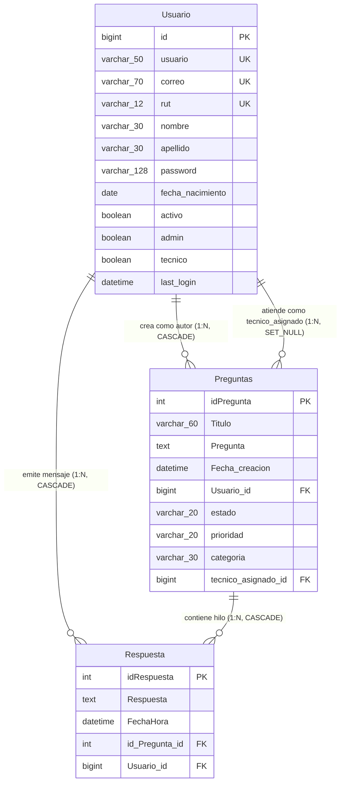

# DOSSIER TÉCNICO Y ESPECIFICACIÓN ARQUITECTÓNICA DEL PROYECTO

# CALLCENTERGAMER (v2.0) — CONTEXTO MAESTRO PARA HUMANOS E INTELIGENCIA ARTIFICIAL

> **PROPÓSITO DE ESTE DOCUMENTO:**
> Este archivo representa la fuente única de verdad (*Single Source of Truth*) del proyecto **CallCenterGamer** tras su estabilización, refactorización integral y preparación productiva. Está diseñado con un nivel de detalle estructural, relacional y algorítmico suficiente para que tanto un ingeniero de software como un docente evaluador o un agente de Inteligencia Artificial (LLM) puedan entender, auditar, defender o extender este repositorio con total precisión.

---

## 1. FICHA TÉCNICA Y RESUMEN EJECUTIVO

| Parámetro                                   | Detalle Técnico                                                                                                                                                                                                                                                          |
| :------------------------------------------- | :------------------------------------------------------------------------------------------------------------------------------------------------------------------------------------------------------------------------------------------------------------------------ |
| **Nombre del Proyecto**                | CallCenterGamer / Call of Gamers (con soporte White-Label Multi-Empresa)                                                                                                                                                                                                  |
| **Tipo de Aplicación**                | Plataforma Web Monolítica de Soporte Técnico y Gestión de Tickets (Helpdesk)                                                                                                                                                                                           |
| **Dominio de Negocio**                 | Asistencia especializada en videojuegos, hardware gaming, software y conectividad (adaptable a cualquier rubro vía variables de entorno `BRAND_*`)                                                                                                                     |
| **Contexto Académico**                | Evaluación Sumativa N° 3 – Asignatura *Programación Back End* (Docente: Boris Astorga Parraguez)                                                                                                                                                                    |
| **Lenguaje y Versión**                | Python 3.12 / 3.13                                                                                                                                                                                                                                                        |
| **Framework Web**                      | Django >= 5.2, < 6.2 (LTS / 6.x)                                                                                                                                                                                                                                          |
| **Base de Datos**                      | **SQLite3 Nativo Exclusivo** (`django.db.backends.sqlite3` -> `BASE_DIR / 'db.sqlite3'`, sin dependencia de `mysqlclient`)                                                                                                                                    |
| **Servidor de Producción (Render)**   | `gunicorn>=21.2.0` (`gunicorn CallCenterGamer.wsgi:application`)                                                                                                                                                                                                      |
| **Archivos Estáticos en Producción** | `whitenoise>=6.6.0` (`CompressedManifestStaticFilesStorage`)                                                                                                                                                                                                          |
| **Formularios y UI**                   | `django-crispy-forms>=2.1` + `crispy-bootstrap5>=2024.2`                                                                                                                                                                                                              |
| **Motor de IA Híbrido**               | 1. **Cloud Generativo:** OpenAI Python SDK (`openai>=1.0.0,<2.0.0`, modelo `gpt-3.5-turbo`)2. **Fallback Local Resiliente:** Clasificador heurístico por palabras clave (`KEYWORDS_CATEGORIAS`) + `RecomendadorIA` (similitud léxica sobre SQLite3) |
| **Variables de Entorno**               | `django-environ>=0.11.2` + `os.environ` (`.env` local / Environment Variables en Render)                                                                                                                                                                            |
| **Modelo de Autenticación**           | Custom User Model (`online.Usuario`) heredado de `AbstractBaseUser`                                                                                                                                                                                                   |
| **Roles Soportados (RBAC)**            | 1. Cliente (`admin=False, tecnico=False`)2. Técnico de Soporte (`tecnico=True`)3. Administrador (`admin=True`)                                                                                                                                                     |
| **Suite de Pruebas Automatizadas**     | **27 tests unitarios y de integración** (`python manage.py test` -> 100% `OK`)                                                                                                                                                                                 |

---

## 2. ARQUITECTURA DE SOFTWARE (PATRÓN MVT + WHITE-LABEL)

El proyecto implementa la arquitectura **Modelo - Vista - Template (MVT)** de Django, distribuida en un paquete central de configuración (que incluye el motor White-Label) y dos aplicaciones desacopladas por responsabilidad funcional (`online` y `administracion`):

```text
CallCenterGamer/
│
├── CallCenterGamer/              <-- Proyecto / Configuración Central
│   ├── __init__.py
│   ├── asgi.py                   <-- Punto de entrada ASGI
│   ├── brand_config.py           <-- Motor White-Label Multi-Empresa (BRAND_CONFIG y categorías)
│   ├── settings.py               <-- Configuración SQLite3, WhiteNoise, Crispy, Logging y Seguridad
│   ├── urls.py                   <-- Enrutador global de peticiones (Routing)
│   └── wsgi.py                   <-- Punto de entrada WSGI para Gunicorn en Render
│
├── online/                       <-- App 1: Portal del Cliente, Modelos Maestros y Motor IA
│   ├── admin.py                  <-- Registro en /admin/ de Usuario, Preguntas y Respuesta
│   ├── apps.py                   <-- AppConfig: 'online'
│   ├── context_processors.py     <-- Inyector global del diccionario {{ brand }} en templates
│   ├── forms.py                  <-- RegisterForm, LoginForm, PreguntasForm, TicketAdminForm, RespuestaForm
│   ├── ia_utils.py               <-- AsistenteIA (OpenAI GPT-3.5 + Fallback Heurístico Local)
│   ├── models.py                 <-- Usuario, Preguntas (Ticket completo), Respuesta
│   ├── recomendaciones_ia.py     <-- RecomendadorIA (Algoritmo local de similitud con Prefetch)
│   ├── tests.py                  <-- 20 pruebas automatizadas (acceso, modelos, forms, IA, White-Label, privacidad y seed)
│   ├── views.py                  <-- Index, PoliticaPrivacidad, Inicio, ViewRespuestas, RegisterView, LoginView, logout_view
│   ├── management/
│   │   └── commands/
│   │       └── seed_initial_data.py <-- Comando idempotente de carga inicial (usuarios y 6 tickets)
│   ├── migrations/               <-- Historial de migraciones (0001 a 0004_preguntas_ticket_fields)
│   ├── static/                   <-- CSS (estiloHeader, inicio, login, register, respuestas), JS e imágenes
│   └── templates/                <-- Plantillas HTML de cliente y header base con variables CSS :root
│
├── administracion/               <-- App 2: Portal de Administración, Soporte Técnico y Analítica
│   ├── admin.py                  <-- Documentación de referencia hacia online/admin.py
│   ├── apps.py                   <-- AppConfig: 'administracion'
│   ├── forms.py                  <-- UserAdminCreationForm, UserAdminChangeForm (ReadOnlyPasswordHashField)
│   ├── models.py                 <-- Consume las entidades maestras de 'online.models'
│   ├── tests.py                  <-- 8 pruebas automatizadas de RBAC, seguridad POST y dashboard admin
│   ├── views.py                  <-- IndexAdmin, BorrarPregunta, GestionUsuarios, EliminarUsuario, ModificarPregunta, AnalyticsIA
│   ├── static/                   <-- Estilos administrativos (index.css, gestion.css, modificar.css, analytics.css)
│   └── templates/                <-- indexAdmin.html, GestionUsuarios.html, ModificarPregunta.html, analytics_ia.html
│
├── logs/
│   ├── .gitkeep
│   └── callcenter.log            <-- Archivo rotativo de auditoría y eventos del sistema
├── db.sqlite3                    <-- Base de datos relacional SQLite3 (migrada y poblada)
├── build.sh                      <-- Script de aprovisionamiento automático para Render
├── requirements.txt              <-- Dependencias productivas de Python
├── .env.example                  <-- Plantilla documentada de variables de entorno
├── .gitignore                    <-- Reglas de exclusión de archivos sensibles/temporales
├── manage.py                     <-- CLI de gestión de Django
└── Start Servidor Web.bat        <-- Script de arranque condicional en Windows (instala/migra/puebla si no existe db.sqlite3, o ejecuta runserver directo si ya existe)
```

### Diagrama Arquitectónico del Flujo de Datos

```mermaid
flowchart TD
    User([Usuario / Navegador]) -->|Petición HTTP GET/POST| WhiteNoise[WhiteNoise Middleware\nArchivos Estáticos]
    WhiteNoise --> DjangoRouter[CallCenterGamer/urls.py]
  
    subgraph Routing_Middleware [Capa de Seguridad y Contexto]
        DjangoRouter --> AuthMW[AuthenticationMiddleware & CsrfViewMiddleware]
        AuthMW --> BrandCP[online/context_processors.py\nInyecta {{ brand }} desde brand_config.py]
    end
  
    BrandCP -->|Ruta de Cliente| OnlineViews[online/views.py]
    BrandCP -->|Ruta Administrativa| AdminViews[administracion/views.py]
  
    subgraph App_Online [App: online]
        OnlineViews <--> OnlineForms[online/forms.py\nPreguntasForm / RespuestaForm]
        OnlineViews <--> DB_Models[(online/models.py:\nUsuario, Preguntas, Respuesta)]
        OnlineViews <--> HybridAI[online/ia_utils.py & recomendaciones_ia.py\nMotor IA Híbrido con Fallback Local]
        OnlineViews --> OnlineTpls[online/templates/]
    end
  
    subgraph App_Admin [App: administracion]
        AdminViews <--> AdminForms[online/forms.py: TicketAdminForm\nadministracion/forms.py]
        AdminViews <--> DB_Models
        AdminViews <--> HybridAI
        AdminViews --> AdminTpls[administracion/templates/]
    end
  
    DB_Models <--> Database[(SQLite3 Nativo\ndb.sqlite3)]
    HybridAI -.->|Si existe OPENAI_API_KEY| OpenAI_Cloud[[OpenAI API: gpt-3.5-turbo]]
    HybridAI -->|Sin API Key o Error de Red| LocalHeuristic[Clasificador y Diagnóstico Local]
```

---

## 3. CONFIGURACIÓN, VARIABLES DE ENTORNO Y LOGGING (`settings.py`)

El archivo [`CallCenterGamer/settings.py`](<file:///C:/Users/Moonlab%20PC/Desktop/proyecto%20CallCenterGamer/proyecto%20CallCenterGamer/Evaluacion%203/CallCenterGamer/CallCenterGamer/settings.py>) carga automáticamente el archivo `.env` (si existe) mediante `django-environ` y aplica configuración segura para desarrollo local y producción en **Render**:

### 3.1. Variables de Entorno Soportadas (`.env.example`)

| Variable                                     | Default                                                      | Propósito                                                                                                                       |
| :------------------------------------------- | :----------------------------------------------------------- | :------------------------------------------------------------------------------------------------------------------------------- |
| `DJANGO_DEBUG`                             | `True` (dev) / `False` (Render)                          | Controla el modo de depuración. Si es `False`, activa cookies seguras y exige `DJANGO_SECRET_KEY` real.                     |
| `DJANGO_SECRET_KEY`                        | Clave de desarrollo                                          | Firma criptográfica de sesiones y tokens CSRF. En producción (`DEBUG=False`) lanza `ImproperlyConfigured` si no se define. |
| `ALLOWED_HOSTS` / `DJANGO_ALLOWED_HOSTS` | `.onrender.com,localhost,127.0.0.1`                        | Dominios autorizados a servir la aplicación. Añade automáticamente `RENDER_EXTERNAL_HOSTNAME`.                              |
| `CSRF_TRUSTED_ORIGINS`                     | `https://*.onrender.com`                                   | Orígenes HTTPS de confianza para validación de formularios POST en Render.                                                     |
| `OPENAI_API_KEY`                           | `""` (vacío)                                              | Clave opcional de OpenAI. Si está vacía, `AsistenteIA` usa su motor heurístico local sin errores.                           |
| `BRAND_NAME`                               | `CallCenterGamer`                                          | Nombre comercial de la plataforma (White-Label).                                                                                 |
| `BRAND_WELCOME_TITLE`                      | `Bienvenido a Call of Gamers!`                             | Título principal del banner en la página de inicio.                                                                            |
| `BRAND_SLOGAN`                             | Texto gamer por defecto                                      | Eslogan descriptivo de la portada.                                                                                               |
| `BRAND_ICON_CLASS`                         | `fas fa-gamepad`                                           | Ícono FontAwesome dinámico del logotipo.                                                                                       |
| `BRAND_PRIMARY_COLOR`                      | `#4E31E1`                                                  | Color primario inyectado en `:root` (`--brand-primary`).                                                                     |
| `BRAND_SECONDARY_COLOR`                    | `#673de6`                                                  | Color secundario inyectado en `:root` (`--brand-secondary`).                                                                 |
| `BRAND_ACCENT_COLOR`                       | `#25c2b5`                                                  | Color de acento inyectado en `:root` (`--brand-accent`).                                                                     |
| `BRAND_AI_ROLE_PROMPT`                     | Prompt experto en gaming                                     | System Prompt dinámico para adaptar el rol del asistente IA a otra empresa.                                                     |
| `BRAND_CATEGORIES`                         | `hardware,software,conexion,cuenta,pago,rendimiento,otros` | Catálogo CSV de categorías válidas para tickets.                                                                              |

### 3.2. Logging Estructurado (Mejora 2)

`settings.py` crea automáticamente el directorio `logs/` y configura el diccionario `LOGGING` con dos salidas simultáneas:

- **`console` (`logging.StreamHandler`):** Captura eventos en tiempo real en la salida estándar (ideal para el visor de logs de Render).
- **`file` (`logging.FileHandler`):** Persiste el historial de auditoría (creación/modificación/borrado de tickets, inicios de sesión, cambios de rol, bloqueos de seguridad y fallbacks de IA) en `logs/callcenter.log`.

---

## 4. MODELO DE DATOS Y ESQUEMA ENTIDAD-RELACIÓN

Todos los modelos residen en [`online/models.py`](<file:///C:/Users/Moonlab%20PC/Desktop/proyecto%20CallCenterGamer/proyecto%20CallCenterGamer/Evaluacion%203/CallCenterGamer/online/models.py>). La aplicación `administracion` consume directamente estas entidades para mantener una única fuente de verdad relacional.

### 4.1. Modelo `Usuario` (Hereda de `AbstractBaseUser`)

Reemplaza al usuario tradicional de Django para soportar identificación por `usuario`, `rut` chileno y banderas explícitas de control de acceso basado en roles:

- `id`: `BigAutoField` (PK).
- `nombre`: `CharField(max_length=30, blank=True, null=True)`
- `apellido`: `CharField(max_length=30, blank=True, null=True)`
- `rut`: `CharField(max_length=12, unique=True, blank=True, null=True)`
- `correo`: `EmailField(max_length=70, unique=True)`
- `usuario`: `CharField(max_length=50, unique=True)` (**`USERNAME_FIELD`**).
- `fecha_nacimiento`: `DateField(null=True, blank=True)`
- `activo`: `BooleanField(default=True)` (Controla `is_active`; impide login si es `False`).
- `admin`: `BooleanField(default=False)` (Otorga acceso total a administración, analítica y `/admin/`).
- `tecnico`: `BooleanField(default=False)` (Otorga acceso a `/Administracion/` y atención de tickets).
- `password` y `last_login`: Gestionados por `AbstractBaseUser` (hash PBKDF2).

### 4.2. Modelo `Preguntas` — Sistema Completo de Tickets (Mejora 1)

Representa un ticket de soporte técnico con trazabilidad completa de ciclo de vida (migración `0004_preguntas_ticket_fields.py`):

- `idPregunta`: `AutoField(primary_key=True)`
- `Titulo`: `CharField(max_length=60)`
- `Pregunta`: `TextField()`
- `Fecha_creacion`: `DateTimeField(default=timezone.now)` (Se autocompleta automáticamente al crear el ticket).
- `Usuario`: `ForeignKey(Usuario, on_delete=models.CASCADE, related_name='preguntas')` (Cliente autor del ticket).
- `estado`: `CharField(max_length=20, choices=ESTADO_CHOICES, default='abierto')`
  - Opciones: `'abierto'` (*Abierto*), `'en_proceso'` (*En proceso*), `'resuelto'` (*Resuelto*), `'cerrado'` (*Cerrado*).
- `prioridad`: `CharField(max_length=20, choices=PRIORIDAD_CHOICES, default='media')`
  - Opciones: `'baja'` (*Baja*), `'media'` (*Media*), `'alta'` (*Alta*), `'critica'` (*Crítica*).
- `categoria`: `CharField(max_length=30, choices=CATEGORIA_CHOICES, default='otros')`
  - Clasificada y persistida en base de datos al crear o editar el ticket (`hardware`, `software`, `conexion`, `cuenta`, `pago`, `rendimiento`, `otros`), evitando recalcular con OpenAI en cada recarga de página.
- `tecnico_asignado`: `ForeignKey('online.Usuario', on_delete=models.SET_NULL, null=True, blank=True, related_name='tickets_asignados', limit_choices_to=Q(tecnico=True) | Q(admin=True))`
  - Si se elimina la cuenta del técnico, el ticket **no se pierde** (`SET_NULL`), pasando a estado sin asignar (`None`).

### 4.3. Modelo `Respuesta` (Mensaje de Conversación)

Representa cada mensaje enviado dentro del hilo de un ticket:

- `idRespuesta`: `AutoField(primary_key=True)`
- `Respuesta`: `TextField(verbose_name='Respuesta')`
- `id_Pregunta`: `ForeignKey(Preguntas, on_delete=models.CASCADE)`
- `Usuario`: `ForeignKey(Usuario, on_delete=models.CASCADE)`
- `FechaHora`: `DateTimeField()`

### Diagrama Entidad-Relación Actualizado (Mermaid ERD)



---

## 5. MATRIZ DE CONTROL DE ACCESO BASADO EN ROLES (RBAC)

| Rol                     | Flags en BD                                 | Permisos y Capacidades                                                                                                                                                                                                                                                                          | Vistas Permitidas                                                                      |
| :---------------------- | :------------------------------------------ | :---------------------------------------------------------------------------------------------------------------------------------------------------------------------------------------------------------------------------------------------------------------------------------------------- | :------------------------------------------------------------------------------------- |
| **Anónimo**      | Sin sesión                                 | Ver portada White-Label, iniciar sesión y registrarse como cliente.                                                                                                                                                                                                                            | `Index`, `LoginView`, `RegisterView`                                             |
| **Cliente**       | `admin=Falsetecnico=False``activo=True` | Usar el buscador de Asistente Virtual IA (`?buscar_ayuda=`), crear tickets definiendo prioridad, ver el estado/prioridad de sus tickets e interactuar solo en sus propias conversaciones.                                                                                                     | `Inicio` (solo su `id`), `ViewRespuestas` (solo sus tickets), `logout_view`    |
| **Técnico**      | `tecnico=Trueadmin=False``activo=True`  | Acceder al dashboard `/Administracion/`, filtrar tickets por estado y prioridad, abrir cualquier conversación, ver la tarjeta de **Asistencia IA para Soporte** y responder tickets.                                                                                                   | `IndexAdmin`, `ViewRespuestas` (cualquier ticket + sugerencia IA), `logout_view` |
| **Administrador** | `admin=Trueactivo=True`                   | Todo lo del Técnico + editar estado/prioridad/categoría/técnico asignado (`ModificarPregunta`), borrar tickets (`BorrarPregunta`), gestionar roles de usuarios (`GestionUsuarios` con autoprotección), eliminar usuarios (`EliminarUsuario`) y ver `/AnalyticsIA/` y `/admin/`. | Todas las vistas del sistema                                                           |

---

## 6. CATÁLOGO COMPLETO DE ENDPOINTS Y VISTAS

| Ruta URL                                           | Nombre URL              | Verbo HTTP | Vista                  | Decoradores                            | Comportamiento Principal y Optimizaciones                                                                                                                                                       | Template                        |
| :------------------------------------------------- | :---------------------- | :--------- | :--------------------- | :------------------------------------- | :---------------------------------------------------------------------------------------------------------------------------------------------------------------------------------------------- | :------------------------------ |
| `/`                                              | `index`               | GET        | `Index`              | Ninguno                                | Portada pública parametrizada con `{{ brand }}`.                                                                                                                                             | `index.html`                  |
| `/PoliticaPrivacidad/`                           | `politica_privacidad` | GET        | `PoliticaPrivacidad` | Ninguno                                | Página informativa de Políticas de Privacidad accesible desde el botón en el footer global para todos los roles (Cliente, Técnico, Admin y visitantes).                                     | `politica_privacidad.html`    |
| `/Login/`                                        | `Login`               | GET, POST  | `LoginView`          | CBV (`FormView`)                     | Autentica credenciales, verifica `activo=True` y redirige según rol (`administracion` o `inicio`).                                                                                       | `login.html`                  |
| `/Register/`                                     | `Register`            | GET, POST  | `RegisterView`       | CBV (`CreateView`)                   | Registra nuevos clientes con hash PBKDF2 y máscara de RUT.                                                                                                                                     | `register.html`               |
| `/Logout/`                                       | `Logout`              | POST       | `logout_view`        | `@require_POST`                      | Cierra sesión de forma segura por POST (bloquea GET con HTTP 405).                                                                                                                             | Redirect a `Login`            |
| `/Inicio/<int:id>/`                              | `inicio`              | GET, POST  | `Inicio`             | `@login_required`                    | Panel del cliente. Conecta `?buscar_ayuda=` con `AsistenteIA` + `RecomendadorIA`. En POST crea tickets y clasifica su categoría automáticamente.                                        | `inicio.html`                 |
| `/Respuesta/<int:idPregunta>/`                   | `respuestas`          | GET, POST  | `ViewRespuestas`     | `@login_required`                    | Hilo de conversación (sin `idUser` en la URL). Verifica propiedad o rol staff. Muestra sugerencia IA para técnicos/admins con botón de copiado rápido.                                    | `Respuestas.html`             |
| `/Administracion/`                               | `administracion`      | GET        | `IndexAdmin`         | `@login_required`                    | Dashboard real sin bucles de redirección. Optimizado con `select_related('Usuario', 'tecnico_asignado')` y `annotate(Count('respuesta'))`. Soporta filtros por `estado` y `prioridad`. | `indexAdmin.html`             |
| `/ModificarPregunta/<int:idPregunta>/`           | `modificar_pregunta`  | GET, POST  | `ModificarPregunta`  | `@login_required`                    | Edición integral del ticket mediante `TicketAdminForm` + panel lateral de diagnóstico IA y casos similares. Exclusivo Admin.                                                                | `ModificarPregunta.html`      |
| `/BorrarPregunta/<int:idUser>/<int:idPregunta>/` | `borrar_pregunta`     | POST       | `BorrarPregunta`     | `@login_required`, `@require_POST` | Elimina un ticket validando `request.user.admin` en sesión (inmune a spoofing de `idUser`).                                                                                                | Redirect a `administracion`   |
| `/GestionUsuarios/`                              | `gestion_usuarios`    | GET, POST  | `GestionUsuarios`    | `@login_required`                    | Optimizado con `prefetch_related('preguntas')`. **Impide que el admin activo se desactive o se quite el rol admin a sí mismo.**                                                        | `GestionUsuarios.html`        |
| `/EliminarUsuario/<int:idUser>/`                 | `eliminar_usuario`    | POST       | `EliminarUsuario`    | `@login_required`, `@require_POST` | Elimina cuentas de usuario impidiendo la autoeliminación del administrador activo.                                                                                                             | Redirect a `gestion_usuarios` |
| `/AnalyticsIA/`                                  | `analytics_ia`        | GET        | `AnalyticsIA`        | `@login_required`                    | Analítica mensual para administradores leyendo categorías persistidas en BD y calculando el SLA real con `Min('respuesta__FechaHora')`.                                                     | `analytics_ia.html`           |

---

## 7. ARQUITECTURA RESILIENTE DE INTELIGENCIA ARTIFICIAL (MEJORA 2)

El motor de IA fue rediseñado para garantizar **alta disponibilidad (100% libre de caídas o mensajes de error expuestos al usuario)** incluso cuando no se configura `OPENAI_API_KEY`:

1. **`AsistenteIA` ([`online/ia_utils.py`](<file:///C:/Users/Moonlab%20PC/Desktop/proyecto%20CallCenterGamer/proyecto%20CallCenterGamer/Evaluacion%203/CallCenterGamer/online/ia_utils.py>)):**
   - **Modo Cloud (`OPENAI_API_KEY` presente):** Invoca `gpt-3.5-turbo` inyectando el prompt de rol configurado en `brand_config.py` (`AI_ROLE_PROMPT`) y las categorías de `get_ticket_categories()`.
   - **Modo Fallback Local Transparente (`OPENAI_API_KEY` vacía o fallo de red/cuota):** Conmuta automáticamente a `_clasificar_localmente()` (diccionario léxico `KEYWORDS_CATEGORIAS`) y `_generar_respuesta_local()` (guías de diagnóstico por categoría enriquecidas con casos reales de `RecomendadorIA`), registrando el evento en `logs/callcenter.log`.
2. **`RecomendadorIA` ([`online/recomendaciones_ia.py`](<file:///C:/Users/Moonlab%20PC/Desktop/proyecto%20CallCenterGamer/proyecto%20CallCenterGamer/Evaluacion%203/CallCenterGamer/online/recomendaciones_ia.py>)):**
   - Utiliza `Prefetch('respuesta_set')` para obtener tickets resueltos y sus respuestas en solo 2 consultas SQL (sin N+1).
   - Calcula similitud léxica ponderada en español y retorna el Top 3 de soluciones históricas.

---

## 8. DESPLIEGUE EN RENDER Y SEMILLAS DE DATOS (FASE 6)

### 8.1. Comando Idempotente `seed_initial_data`

Definido en [`online/management/commands/seed_initial_data.py`](<file:///C:/Users/Moonlab%20PC/Desktop/proyecto%20CallCenterGamer/proyecto%20CallCenterGamer/Evaluacion%203/CallCenterGamer/online/management/commands/seed_initial_data.py>). Puede ejecutarse múltiples veces sin duplicar registros (`get_or_create`):

- **Usuarios de demostración por defecto:**
  - Administrador y Técnico: `admin` / `admin@gmail.com` / `admin123` (`admin=True, tecnico=True, activo=True`)
  - Técnico: `tecnico` / `tecnico@gmail.com` / `tecnico123` (`admin=False, tecnico=True, activo=True`)
  - Usuario Normal (Cliente): `usuario` / `usuario@gmail.com` / `usuario123` (`admin=False, tecnico=False, activo=True`)
- **Tickets semilla:** 6 tickets distribuidos en estados `abierto`, `en_proceso` y `resuelto`, con distintas prioridades, categorías y respuestas técnicas iniciales.

### 8.2. Script Productivo `build.sh` para Render

```bash
#!/usr/bin/env bash
set -o errexit

pip install -r requirements.txt
python manage.py collectstatic --noinput
python manage.py migrate --noinput
python manage.py seed_initial_data
```

- **Start Command en Render:** `gunicorn CallCenterGamer.wsgi:application`

### 8.3. Arranque Automático con `Start Servidor Web.bat` y Comandos Manuales

- **Ejecución Automática en Windows ([`Start Servidor Web.bat`](<file:///C:/Users/Moonlab%20PC/Desktop/proyecto%20CallCenterGamer/proyecto%20CallCenterGamer/Evaluacion%203/CallCenterGamer/Start%20Servidor%20Web.bat>)):**
  - **Si `db.sqlite3` NO existe:** Ejecuta automáticamente `pip install -r requirements.txt` -> `manage.py check` -> `manage.py migrate` -> `manage.py seed_initial_data` -> `manage.py runserver 127.0.0.1:8000`.
  - **Si `db.sqlite3` YA existe:** Omite la instalación y migraciones e inicia directamente `manage.py runserver 127.0.0.1:8000`.

```powershell
# Comandos equivalentes de ejecución y verificación manual:
# 1. Verificar configuración del proyecto (0 issues)
python manage.py check

# 2. Aplicar migraciones y poblar datos iniciales en db.sqlite3
python manage.py migrate
python manage.py seed_initial_data

# 3. Ejecutar la suite completa de 27 pruebas automatizadas
python manage.py test -v 2

# 4. Levantar servidor local
python manage.py runserver 127.0.0.1:8000
```

---

## 9. REGISTRO DE DEUDA TÉCNICA RESUELTA (AUDITORÍA PPT 5 Y PAUTA EVALUACIÓN N° 3)

Todos los problemas identificados en la auditoría inicial fueron solucionados y validados mediante tests:

1. **Bucle infinito en `/Administracion/` resuelto:** Se eliminó `<script>window.location.href = '/Administracion/';</script>` de `indexAdmin.html` y se construyó el dashboard administrativo completo con tarjetas de KPIs, alertas, filtros y tabla CRUD.
2. **Eliminación de N+1 Queries y llamadas bloqueantes a OpenAI:** `IndexAdmin`, `GestionUsuarios` y `AnalyticsIA` ahora usan `select_related`, `prefetch_related` y `annotate`, leyendo la categoría persistida en `Preguntas.categoria`.
3. **Cierre de brechas de seguridad (IDOR / Spoofing):**
   - `PreguntasForm` y `RespuestaForm` ya no exponen campos ocultos manipulables (`Usuario`, `Fecha_creacion`, `id_Pregunta`).
   - La URL `/Respuesta/<int:idPregunta>/` eliminó el segmento `idUser`.
   - `GestionUsuarios` y `EliminarUsuario` bloquean la autodesactivación, autodegradación y autoeliminación del administrador en sesión.
4. **Normalización de Plantillas:** Todas las plantillas extienden `componentes/header.html` usando bloques estándar ``, ``, `` y `` con sintaxis limpia sin entidades HTML escapadas.
